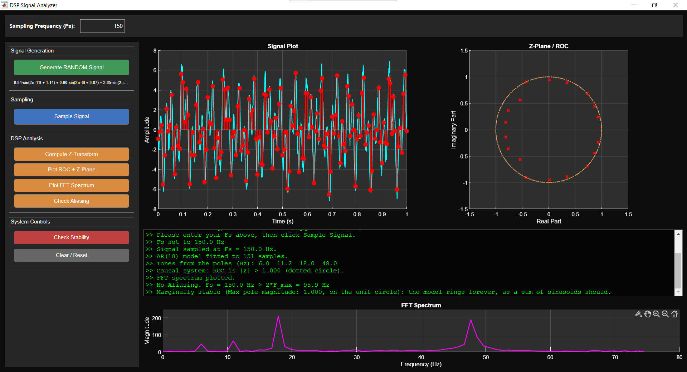
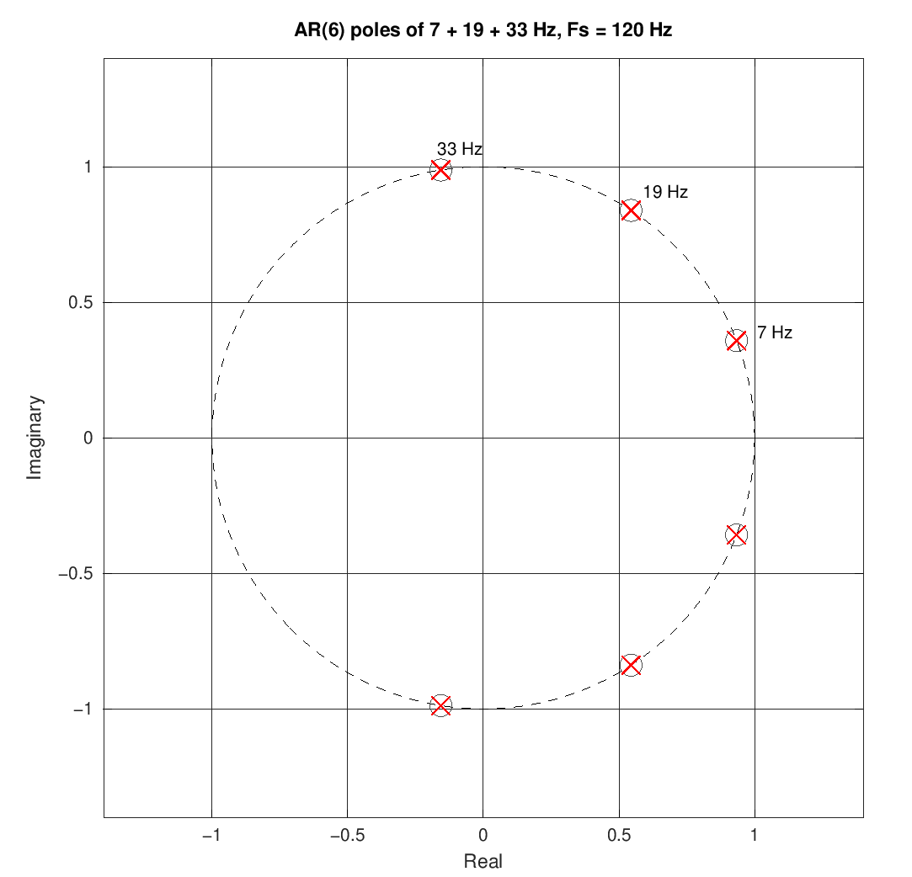
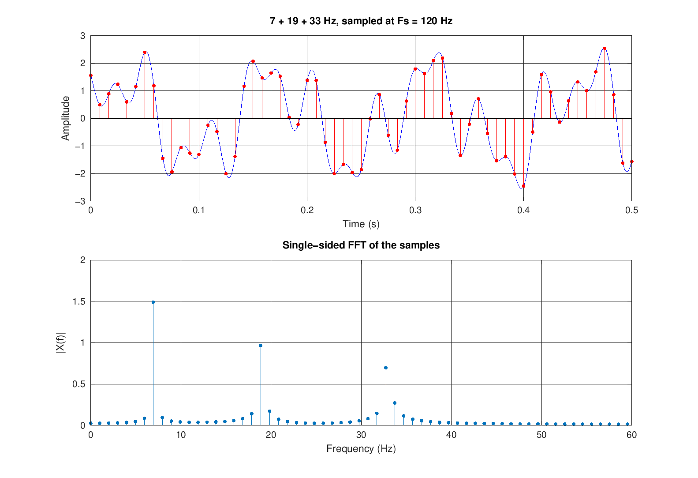
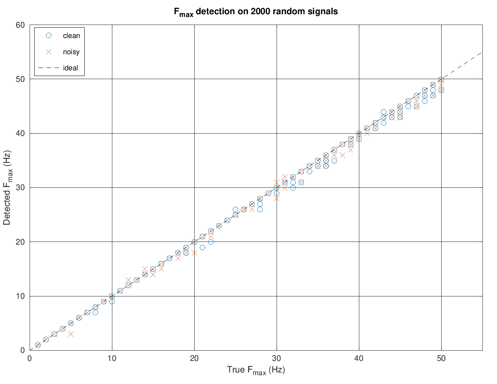
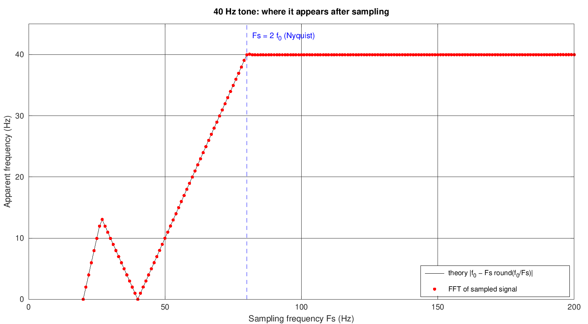

# DSP Signal Analyzer (MATLAB)

Interactive MATLAB app that generates a random multi-tone signal, samples it, checks for aliasing, plots its FFT, fits a pole model in the z-plane and checks stability. Every number the app reports is backed by a measured accuracy test.

**Built:** Fall 2025 · Digital Signal Processing course project

<p align="center">
  
</p>

<p align="center">
  
  
</p>

## Results

| Metric | Result |
| --- | --- |
| F_max detection (2,000 random signals, correct = within 2 Hz) | 98.8 % on noisy signals, 97.9 % on clean ones, median error 0 Hz |
| Tone recovery from the z-plane poles | Every tone within 1 Hz in 91 % of clean signals and 79 % of noisy ones; median pole radius 1.000 |
| Worked example (7 + 19 + 33 Hz at Fs = 120 Hz) | Poles at 7, 19, 33 Hz, radius 0.9999–1.0000 |
| Aliasing prediction vs FFT of the samples | Matches at 181 of 181 sampling rates (20–200 Hz, within 0.2 Hz) |

## How it works

1. **Generate.** 1–5 sinusoids (0.5–3 amplitude, 1–50 Hz, random phase) on a 1 kHz grid over 1 s, with white noise half the time.
2. **Find F_max.** Hann-windowed FFT, then the highest spectral peak that stands above both 5 % of the largest peak and 10× the median level (the noise floor). The app prints the minimum Fs = 2·F_max.
3. **Sample.** Takes the user's Fs and overlays the samples on the signal.
4. **Check aliasing.** Warns when Fs ≤ 2·F_max.
5. **FFT.** Single-sided magnitude spectrum of the samples.
6. **Z-transform.** Fits an all-pole model H(z) = 1/A(z) to the samples by forward-backward least squares, with order 2K + 10, where K is the number of detected tones.
   - A sum of K sinusoids is exactly an AR(2K) process, with poles on the unit circle at angles ±2πf/Fs. The app reads the tone frequencies back off the poles.
   - The extra 10 poles absorb noise and stay inside the circle.
7. **ROC + z-plane.** Plots the poles and the causal ROC, |z| > max|pole|.
8. **Stability.** Reports stable (all poles inside), marginally stable (poles on the circle, i.e. sustained tones) or unstable.

<p align="center">
  
  
</p>

## Engineering notes

- **Why a windowed peak detector.** White noise has energy at every frequency, so a plain "highest bin above x % of the peak" rule finds noise near the top of the spectrum and asks for a sampling rate far higher than needed. Without a window, leakage skirts also push the estimate a few Hz high. Windowing, then counting only local peaks above the noise floor, avoids both.
- **Why an AR model for the z-plane.** Modelling the samples as the output of an all-pole filter gives poles with a physical meaning: their angles are the tone frequencies, and their radius shows whether a tone persists (on the circle) or decays (inside). That is also why a signal made of pure tones is reported as marginally stable.
- **Nyquist is strict.** A tone at exactly Fs/2 can be sampled at its zero crossings and vanish, so the app warns at Fs ≤ 2·F_max. The folding formula |f₀ − Fs·round(f₀/Fs)| is checked against the FFT at every rate from 20 to 200 Hz (`analysis/aliasing_check.m`).

## Repository layout

```
src/
  dsp_project.m           the app
analysis/                 accuracy tests, MATLAB or GNU Octave, no toolboxes
  make_signal.m           the app's random-signal recipe, reproducible by seed
  fmax_detect.m           the app's F_max detector
  fmax_detection_check.m  detector accuracy on 2,000 random signals
  ar_poles.m              forward-backward least-squares AR model
  ztransform_check.m      tone recovery from the poles, worked example
  aliasing_check.m        folded frequency: theory vs FFT
media/                    figures from the analysis scripts
```

## Run it

**App:** MATLAB R2020b or newer, no toolboxes.

1. Open the `src` folder in MATLAB and type `dsp_project`. The window opens full screen.
2. Click **Generate RANDOM Signal**, type an Fs above the suggested minimum and press Enter.
3. Click **Sample Signal**, then the analysis buttons in any order. **Clear / Reset** starts over.

**Tests:** open `analysis` and run `fmax_detection_check`, `ztransform_check` or `aliasing_check`. Each takes a few seconds and saves its figure to `media/`.

## Challenges and fixes

- **Telling tones from noise.** A fixed threshold either misses weak tones or catches noise. Tying the threshold to the median spectrum level, which is the noise floor, and requiring a local peak solved both.
- **Choosing the model order.** Order 2K fits clean tones exactly but is pulled off by noise. Adding 10 spare poles lets the noise settle inside the circle, while the K poles closest to the circle stay on the tones.

## Limitations and next steps

- With few samples (Fs near 2·F_max) a weak tone can be misplaced by a few Hz. More samples (longer signals or higher Fs) fix this.
- Two tones closer than about 1 Hz cannot be separated in a 1 s record.
- Sampling is simulated by linear interpolation of the 1 kHz grid, so very high Fs adds no new information.
- Next: an anti-aliasing filter before sampling, and Burg's method as an alternative AR estimator.

## Author

**Michel Salame** — [LinkedIn](https://www.linkedin.com/in/michel-salame)
